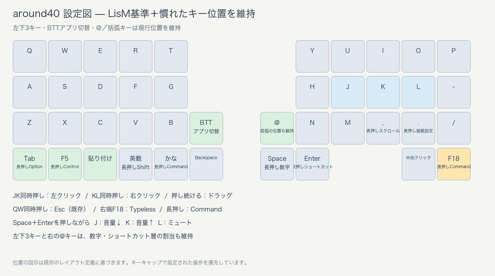

# around40 最終設定

藤吉用のAround Forty RightBall。LisMの慣れた配置を基準に、キーキャップで固定している操作を維持しています。

**正本はこのリポジトリの `main`、書込み用ファームウェアは [最新リリース](https://github.com/nobbie55/zmk-config-AroundFortyRB/releases/latest) の `around40-final.zip` です。**

- JK：左クリック、KL：右クリック。オートマウスなしでも使え、押し続けるとドラッグできます。
- 左Backspaceの上：既存のBTTアプリ切替ボタン（マウス第4ボタン）。
- 右端：F18（Typeless）、長押しCommand。
- 左下3キー：Tab／長押しOption、F5／長押しControl、貼り付け。位置・各レイヤーの操作を維持。
- 右内側：@、鍵括弧、丸括弧の既存割当を維持。
- QW：Esc（既存）。
- Space＋Enterを押しながらJ／K／L：音量下げ／音量上げ／ミュート。

[詳しい使い方と書込み手順](docs/使い方.md)

以前の `Data/Firmware` にあったUF2・配置図は現行版と一致しないため、配布先から外しました。旧版はGit履歴から復元できます。

メーカーの利用ガイド：https://note.com/razily/n/n0b3c5ff58d92
